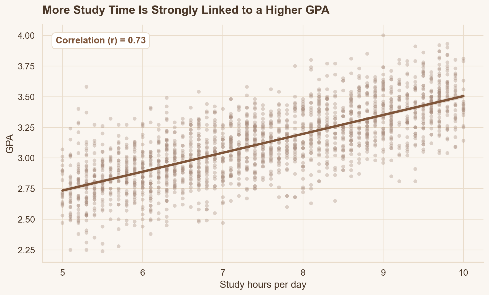
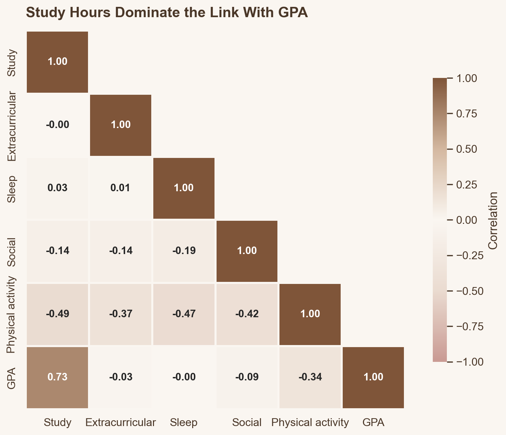
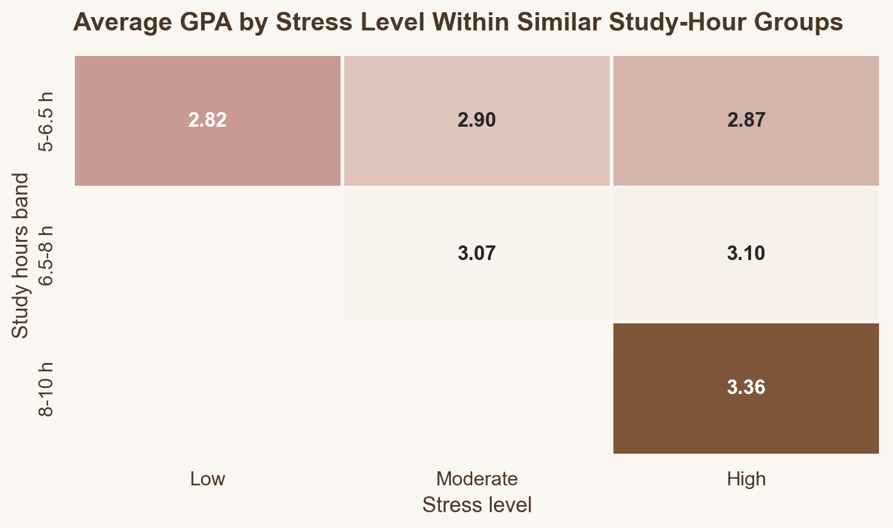
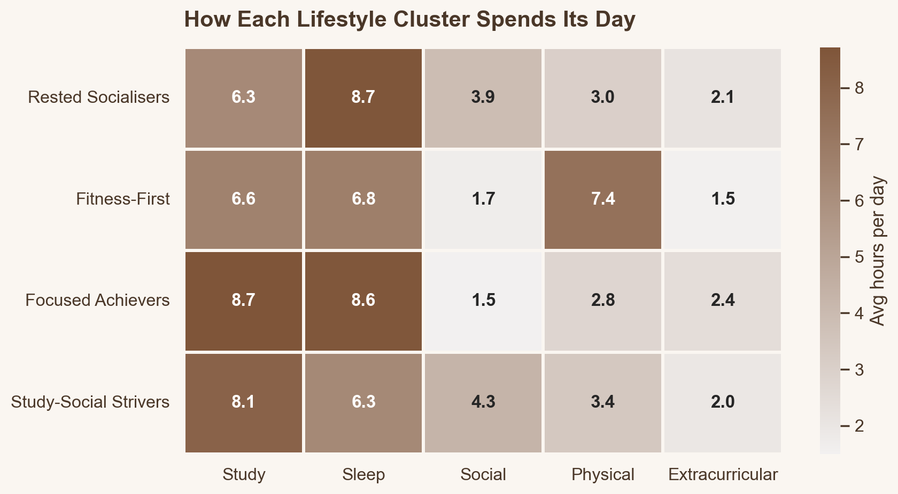

# StudentPulse Analytics

**Discovering how student lifestyle habits relate to academic performance and stress.**

Python | Pandas | NumPy | Matplotlib | Seaborn | Scikit-learn | SciPy

## Overview
This project analyses 2,000 student records to understand how daily habits (study, sleep, social time, physical activity and extracurriculars) relate to GPA and reported stress. It combines exploratory analysis, statistical testing, K-Means clustering and a regression model.

## Key Findings
- **Study time is the dominant factor.** Study hours correlate strongly with GPA (r = 0.73). A regression using daily lifestyle hours explains about 55% of GPA variation on unseen data, almost all of it through study hours.
- **Stress mostly reflects study time.** High-stress students have the highest GPA (3.26 vs 2.82 for low stress) but also study far more (8.4 vs 5.5 hours per day). Within similar study-hour bands, GPA barely changes with stress.
- **Four lifestyle profiles** were identified with K-Means. GPA differs significantly across them (ANOVA p < 0.001, eta-squared = 0.25), led by "Focused Achievers" (average GPA 3.30).
- **Time is a trade-off.** Every student's day sums to exactly 24 hours, which shapes the correlations between variables.

## Visuals

## Methods
1. Data validation: missing values, duplicates, range and 24-hour consistency checks
2. Exploratory data analysis and correlation analysis
3. Stress analysis, including a check controlling for study hours
4. K-Means clustering (k = 4), with elbow and silhouette analysis
5. Statistical tests: ANOVA, Kruskal-Wallis, effect size, Spearman correlation
6. Linear regression to predict GPA

## Limitations
The data appears constructed: every record's lifestyle hours sum to exactly 24.0 and stress is almost fully tied to study time. Results demonstrate the analytical method and are not evidence about real student populations. All findings are associations, not causes. Clusters overlap (silhouette about 0.22).

## Data Source
[Dataset title] by [author name], from Kaggle: [Kaggle link]. Licence: [licence].

## How to Run
1. Download or clone this repository
2. Install the libraries: `pip install pandas numpy matplotlib seaborn scikit-learn scipy jupyter`
3. Open `StudentPulse_Analytics.ipynb` in Jupyter and run all cells

## Author
**[THENDRAL K.]** | Aspiring Data Analyst | Bengaluru, India
GitHub: [thendral1712](https://github.com/thendral1712)
LinkedIn: [https://www.linkedin.com/in/thendral-k-9a6515376/]
